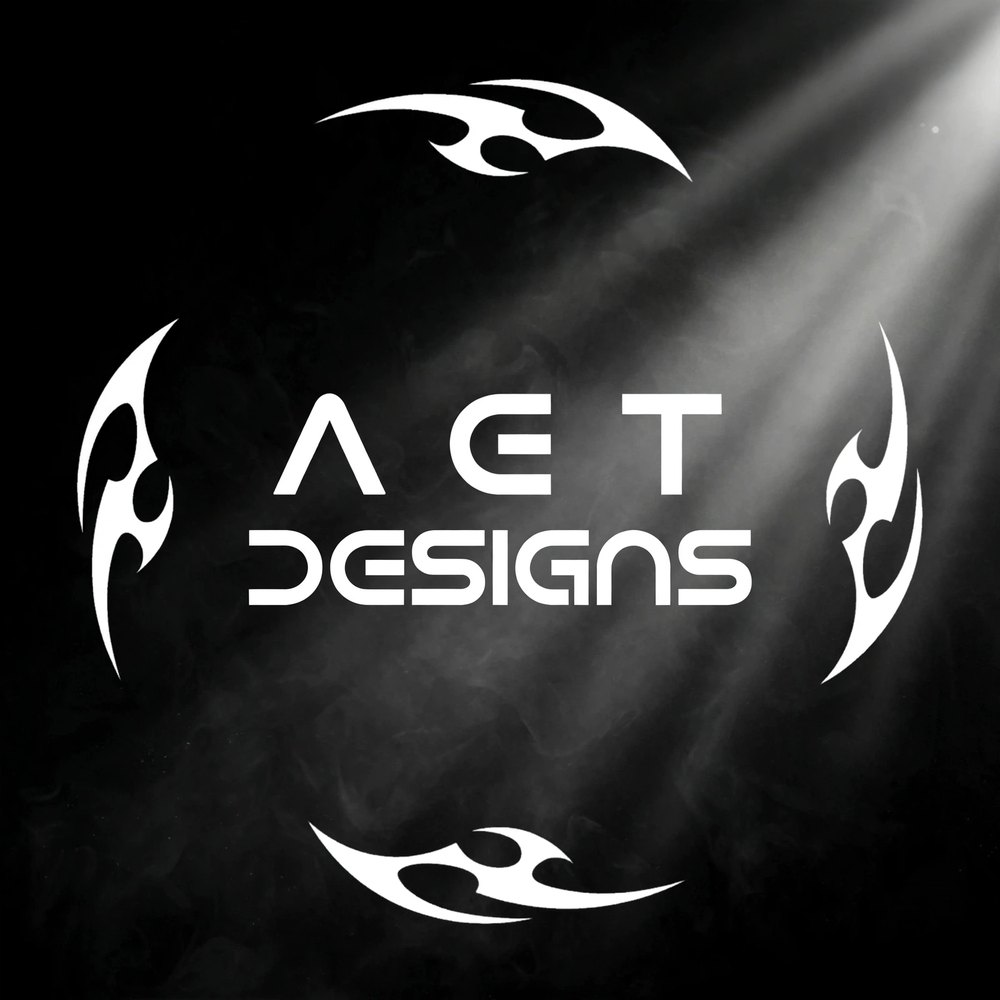

<p align="center">
  
</p>

<h1 align="center">AET Designs — Graphic Portfolio 2026</h1>

<p align="center">
  <strong>Graphic Designer + Software Engineering Student</strong><br/>
  Amr Essam — Kafr El Dawar, Egypt
</p>

<p align="center">
  <a href="https://devvoltx.github.io/Graphic-Protofolio-By-Amr/">🔥 Live Demo</a> •
  <a href="https://amressam.is-a.dev">💻 Dev Portfolio</a> •
  <a href="https://www.instagram.com/3am_our1430">📸 Instagram</a>
</p>

---

## ✨ Features

- **Identity taken from the AET logo:** pure black, white and smoke grey with a spotlight beam and tribal blade dividers — deliberately different from the dev portfolio
- **The logo is the hero:** its black background melts into the page; same logo is the favicon and social preview
- **One filterable gallery:** ALL / LOGOS / CAR POSTERS / CLIENTS in a masonry layout (work is greyscale and lights up in colour on hover on desktop)
- **Lightbox viewer:** click any piece to see it full size (← / → / Esc / swipe), navigates only through the active filter
- **Responsive & accessible:** alt text, keyboard focus, skip link, reduced-motion support, lazy-loaded images

## 🛠️ Tech Stack

HTML5 • CSS3 (variables, grid, flexbox) • Vanilla JavaScript • Fonts: Orbitron + Rajdhani • Hosted on GitHub Pages

## 📁 Project Structure

```
Graphic-Protofolio-By-Amr/
├── images/
│   ├── aet-logo.jpg          # Main logo (hero + gallery)
│   ├── wolf-a-logo.jpg       # A Wolf logo (gallery)
│   ├── avatar.jpg            # About section photo
│   ├── logo1.jpg … logo6.jpg # Logo gallery
│   ├── car1.jpg … car8.jpg   # Car posters
│   └── client1.jpg, client2.jpg
├── favicon.ico / favicon-16.png / favicon-32.png
├── apple-touch-icon.png      # iOS home screen icon
├── icon-192.png / icon-512.png
├── og-image.jpg              # Link preview (1200×630)
├── index.html
├── style.css
└── script.js
```

## 🎨 Colors

| Color | Hex       | Usage                  |
| :---- | :-------- | :--------------------- |
| Black | `#000000` | Background (matches logo) |
| White | `#f4f4f4` | Text / buttons / accents |
| Grey  | `#9a9a9a` | Secondary text         |

## 🚀 Run

```bash
git clone https://github.com/DEVVOLTX/Graphic-Protofolio-By-Amr.git
```
Open `index.html` — no build step needed.

## 📬 Contact

- Email: amrt6509@gmail.com
- Phone: +20 155 165 7717
- Instagram: https://www.instagram.com/3am_our1430
- X: https://x.com/Amr2043275
- GitHub: https://github.com/DEVVOLTX
- Dev Portfolio: https://amressam.is-a.dev

## 📄 License

© 2026 Amr Essam — AET Designs. All designs and code are owned by Amr Essam. Please don't copy without permission.
