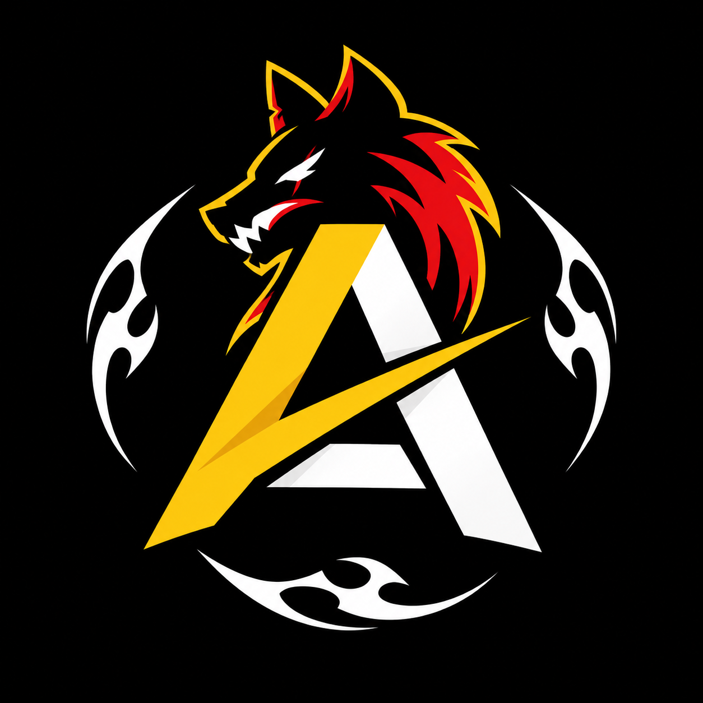

A.ESSAM — A Wolf Brand | Graphic Portfolio 2026

<p align="center">
  
</p>

<p align="center">
  <strong>Graphic Designer + Software Engineer</strong><br/>
  Founder of <b>A Wolf Brand</b> — Kafr El Dawar, Egypt
</p>

<p align="center">
  <a href="https://devvoltx.github.io/Graphic-Protofolio-By-Amr/">🔥 Live Demo</a> •
  <a href="https://amressam.is-a.dev">💻 Dev Portfolio</a> •
  <a href="https://www.instagram.com/3am_our1430">📸 Instagram</a>
</p>

---

🎨 About Me

Hi, I'm **Amr Essam**. I'm a passionate Graphic Designer and Software Engineering student.

I build bold, clean, story-driven designs — logos, car posters, client branding, and cinematic edits.

> **Every design tells a story.**

✨ What's New in V2 (2026)

- **New Brand Identity:** Wolf A logo with signature orange `#FF8C00`
- **Featured Logo:** New wolf brand is highlighted as the main logo
- **Smart Navigation:** Sidebar links + URL hash + Arrow keys + Mobile swipe
- **Memory:** Saves last visited section in `localStorage`
- **Performance:** Lazy loading for all images + optimized cutout
- **Fully Responsive:** Mobile, tablet, desktop

🛠️ Tech Stack

- **HTML5** — Semantic sections
- **CSS3** — CSS Variables, Grid, Flexbox, Radial gradients
- **JavaScript** — 100% Vanilla, no frameworks
- **Fonts** — Anton (titles) + Inter (body)
- **Hosting** — GitHub Pages

📁 Project Structure

Graphic-Protofolio-By-Amr/
├── images/
│   ├── http://wolf-a-logo.png          # NEW 2026 Main Brand
│   ├── http://wolf-a-letter-only.png   # Letter A isolated
│   ├── http://avatar-cutout.png        # Hero cutout
│   ├── http://logo1.jpg - http://logo6.jpg    # Logo gallery
│   ├── http://car1.jpg - http://car8.jpg      # Car posters
│   └── http://client1.jpg, http://client2.jpg # Client work
├── http://index.html                   # Main structure
├── http://style.css                    # All styles + variables
├── http://script.js                    # Navigation + swipe + storage
└── http://README.md                    # This file

🎨 Brand Colors

| Color | Hex | Usage |
| :--- | :--- | :--- |
| Yellow | `#FFC400` | Accent / Active state |
| Orange | `#FF8C00` | Wolf Brand / Theme color |
| Ink | `#0a0a14` | Background |
| White | `#FFFFFF` | Text / Titles |

🚀 How to Run

1. Clone the repo:
   ```bash
   git clone https://github.com/DEVVOLTX/Graphic-Protofolio-By-Amr.git
2. Add `wolf-a-logo.png` to `/images/` folder
3. Open `index.html` — no build step needed, it just works.

🧭 Navigation Logic
// Core function
function show(id) {
  // 1. Toggle active class on panels
  // 2. Toggle active class on sidebar links
  // 3. Save to localStorage
  // 4. Update URL hash
}
- Click → `show()` 
- Keyboard → ArrowUp / ArrowDown / ArrowLeft / ArrowRight
- Mobile → Swipe left / right
- URL → `.../#logo` opens Logo section directly

📬 Contact & Links

- *Email:* amrt6509@gmail.com
- *Phone:* +20 155 165 7717
- *Instagram:* https://www.instagram.com/3am_our1430
- *X (Twitter):* https://x.com/Amr2043275
- *GitHub:* https://github.com/DEVVOLTX
- *Portfolio V1:* https://devvoltx.github.io/Amr/
- *Dev Portfolio:* https://amressam.is-a.dev

📝 Sections
ID	Title	Content
`main`	Main	Hero with 2026 badge + cutout
`about`	About Me	Bio + Tools (Ps, Ai, Pr, PicsArt)
`logo`	Logo	7 logos, new wolf featured
`cars`	Car Posters	8 automotive posters
`clients`	Client Work	Hamo Samy & Mohammed edits
`contact`	Contact	All social links + badge
📄 License

© 2026 Amr Essam — A Wolf Brand. All designs and code are owned by Amr Essam. Please don't copy without permission.

---

<p align="center">
  <b>Built with ❤️ by DevVoltX</b><br/>
  <sub>Available for Freelance — Let's create something bold.</sub>
</p>
